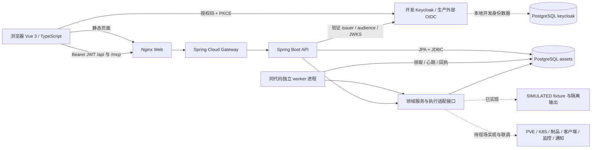
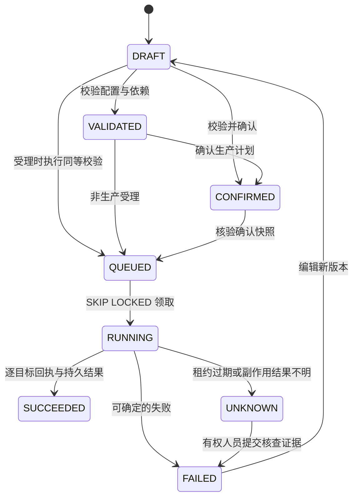

# 资产台账系统架构

本文对应当前独立工程源码。交付内容包括原型七类业务页面、连接与审计设置、可运行的 API、持久化 worker、数据迁移和外部适配接口；不是完整 AIDevOps 平台，也不表示所有 SRS 条目已完成。需求映射及未完成项见 [需求追踪](requirements-traceability.md)，表结构见 [数据设计](data-design.md)。

## 1. 运行拓扑与职责

前端使用 Vue、Vue Router、Pinia、Element Plus、ECharts 和 `oidc-client-ts`。资产总览、资产管理、计算资源、环境部署、应用部署、应用分发、告警管理沿用原型的布局；设置页维护连接、授权、采集计划和审计。浏览器只调用服务接口，不把 IndexedDB 当业务主账。

Java 21 的 API 和 worker 来自同一后端代码及镜像，通过 `assets.role` 区分。API 接收 HTTP/MCP 请求；worker 领取持久任务并进行周期采集、任务调度和故障规则检查。Gateway 统一入口，业务授权仍由 API 领域服务执行。当前是模块化单体与独立 worker，不要求注册中心、Redis、RabbitMQ 或 Kubernetes 才能首次安装。

PostgreSQL 保存资产元数据、配置快照、任务、观测、告警和审计。开发 Compose 在同一个 PostgreSQL 服务内使用 `assets`、`keycloak` 两个数据库；它们可以分别备份恢复，但共用本地数据卷，不构成独立故障域或高可用架构。Flyway 管理结构变更，Hibernate 仅校验；已部署的迁移不得原地改写。

## 2. 身份、项目范围与工具入口

浏览器使用授权码与 PKCE 登录；API 检查 JWT 签名、有效期、issuer 和 `assets-api` audience。平台不另建人员密码库。`access_grants` 以 `(principal_id, project_id)` 保存当前权限，服务端同时核验项目范围、操作权限、启用状态以及人员/服务身份类型。OIDC 登录成功或拥有名称为 `admin` 的角色，均不会自动获得平台管理员权限。

`/api/v1/auth/me` 返回各项目的 `projectPermissions`，前端据此显示按钮；每次服务端操作仍重新检查授权，不能依靠隐藏按钮实现隔离。管理员也只在已授予的项目内管理授权。项目隔离由应用层校验实现，当前不宣称已实施 PostgreSQL 行级安全策略。

任务队列冻结发起主体，worker 在执行前和每个目标执行前核查数据库中的当前授权。周期任务和周期采集必须指定独立 `serviceSubject`；服务身份没有授权或被停用时拒绝执行，不能继承某次登录人员的权限。生产操作及回退还核查 `deployment.confirm`。后台执行审计保留授权主体及运行编号。

`/mcp` 是带 JWT 认证的 Streamable HTTP 工具入口，提供资产查询/登记/同步预览与确认、任务查询/执行、运行状态与日志等受限工具。传输上下文中的主体经 `Access.runAs` 进入同一领域服务，继续执行当前授权、项目、版本和幂等检查；工具不会获得额外权限，也不提供任意命令或任意 URL 执行能力。MCP 不提供绕过生产确认的自动批准入口。

## 3. 资产、类型化任务与配置关系

资产主账区分 `SERVER`、`CLIENT`、`NETWORK`、`SOFTWARE`，保存分类、归属、位置、运维、生命周期、技术参数及外部身份。`assetId` 是平台身份；外部身份由项目、模式、连接器与 `externalId` 共同限定。登记、入库和资源就绪是不同事实：手工登记默认 `UNKNOWN`，入库不会自动产生真实资源或健康结论。

导入与同步先生成逐行差异预览，再由有权人员确认。预览保存目标版本并保护人工维护字段，过期或版本冲突必须重新预览。模拟发现仅生成明确标识的 fixture 候选；停止或删除台账记录不会调用云端删除。

| 任务类别 | 类型与主要约束 |
| --- | --- |
| `CLUSTER` | PVE、K8S；显式物理节点、角色、网络、存储与凭据引用；K8S 另需服务网段 |
| `VM` | GENERAL、COMPUTE、STORAGE；依赖成功的 PVE 集群，单一宿主，核验成员、模板及 CPU/内存/磁盘容量 |
| `ENVIRONMENT` | 容器平台、微服务框架、客户端环境、热更新服务；分别校验对应必填配置及声明的前置任务 |
| `DEPLOYMENT` | 制品外部引用与 SHA-256、已成功环境、命名空间、策略、健康检查、超时和失败策略；生产执行先确认 |
| `DISTRIBUTION` | Flatpak、客户端推送、Flutter 热更新；各自核验包、版本、仓库/运行时或入口/校验配置 |

`asset_relationships` 表达成员、宿主、部署、使用和依赖关系，双方必须为同项目、同模式的已入库资产。任务配置还通过 `targetIds`、`physicalAssetIds`、`clusterId`、`hostId`、`environment` 和 `dependsOnTaskIds` 表达领域引用；这些 JSON 内引用由应用层校验，不能把数据库无外键理解为允许任意跨项目引用。`/model/catalog` 提供当前概念映射，不代表已完成上级规制模型或组件版本联调。

制品、代码和知识文档仍以外部权威仓库为准。本工程保存制品引用、摘要及版本证据，不把上传或登记制品名称当作真实构建、签名或发布完成。原始凭据不能进入任务配置和快照；连接仅保存 `credentialRef`，真实凭据提供方式随现场适配实施。

## 4. 持久执行、确认与未知结果

每次执行冻结任务配置、制品引用/摘要、目标版本、依赖版本及成功运行编号、授权主体。生产确认后修改配置、目标或依赖，需要重新确认。`version` 拒绝覆盖更新；同项目幂等键重复且请求一致时返回原回执，内容变化返回冲突。每个任务同时只能存在一个 `QUEUED`、`RUNNING` 或 `UNKNOWN` 运行。

worker 以 PostgreSQL `FOR UPDATE SKIP LOCKED` 领取任务，持有 30 秒租约，按目标续约，所有结果写入携带 worker ID 与 fencing token。旧 worker 或过期租约不能提交结果。进程退出后，未领取的任务继续排队；已领取且租约过期的任务转为 `UNKNOWN`，不自动重放可能产生副作用的操作。任务日志与逐目标结果分别保存，不能用总体成功覆盖部分目标的不确定结果。

当前 `SIMULATED` 执行只允许 `demo` 项目和同模式目标，输出仅写入独立的 `task_simulated_resources`；资源结果标明 `observed=false`。`REAL` 执行适配器尚未实现，受理入口返回 `503 NOT_CONFIGURED`，不排入伪成功执行。真实未知结果没有核查适配器时，也不能仅凭人工说明标记真实成功；模拟成功核查必须已有持久输出。失败核查保留证据，后续执行使用新的幂等键。

回退生成独立运行并引用冻结的历史结果；首次部署撤回，已有上一版本时恢复对应模拟基线。当前只实现模拟回退，真实回退仍需现场适配器核查、执行和证据确认。业务状态、日志或回退记录本身不代表真实系统已经变化。

任务周期调度默认关闭。启用后每次重新获取服务身份授权，停机错过的周期直接跳过，不能补发积压部署或分发操作。

## 5. 周期采集、观测与实际边界

`collection_schedules` 默认关闭，明确服务身份、周期、IANA 时区和采集范围。模拟发现只接受 `fixture/demo-lan`；同步必须显式绑定 1–100 个 `assetIds`，禁止以空列表隐式授权全池。worker 原子领取到期 tick、推进下一次时间并跳过积压，再通过服务身份调用资产领域服务。采集队列使用 60 秒租约与 fencing token，未知执行须经人工核查关闭后才允许后续周期。

周期同步成功状态为 `PREVIEW_READY`，运行回执保留 `previewId`。它只生成待确认差异；有权人员仍需通过同步确认接口审核并应用，后台不会自动覆盖人工字段。真实计划可以保存为关闭状态，启用或单次执行返回未配置；单次真实执行保留失败回执，不假称已经扫描。

观测事实与资产主账分离；无数据和过期观测返回未知，不生成正常健康。规则判定、人员处置和观测恢复分别保存。站内通知持久化可用；邮件/Webhook 未接入时为 `NOT_CONFIGURED`，不把受理或本地记录称为外部送达。

PVE、K8S、Flatpak、Flutter、真实监控采集与外部通知均需要现场实现和联调，不能仅填写连接 URL 就执行。当前代码也未完成真实设备管理、身份组织全量同步、跨系统制品/流水线联调、40 TB 存储性能、高可用、容量或合同验收。生产接入应按 [部署说明](deployment.md) 配置外部身份、数据库、最小授权和备份，再逐项启用经过验证的适配器。
