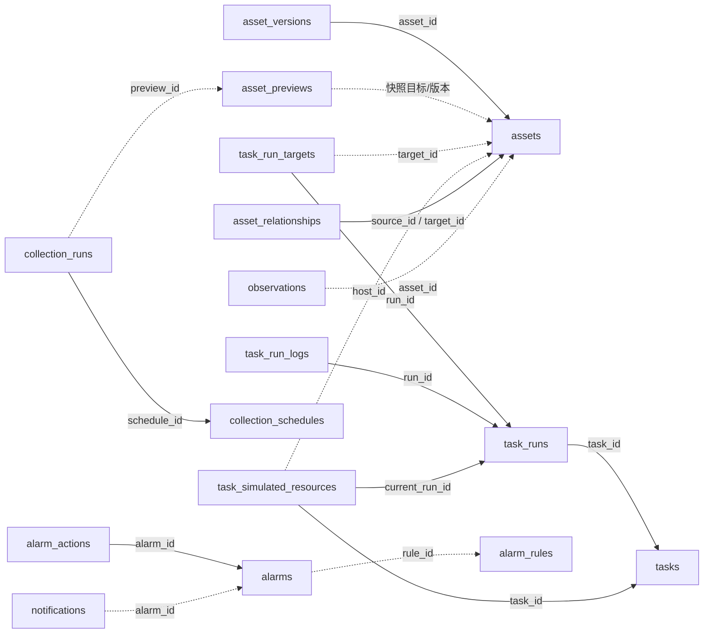

# 资产台账数据设计

本文描述当前代码和 Flyway V1～V7 的实际存储模型。业务数据库为 PostgreSQL；资产使用 JPA，任务、权限、连接、告警和通知主要使用 JdbcTemplate。Hibernate 只做 `validate`，表结构由 Flyway 管理。已经部署的迁移文件不应原地修改；后续结构调整新增迁移。

本工程存储资产元数据、配置、权威引用、执行证据与观测记录，不提供制品二进制仓库、源码仓库或知识文档正文存储。CSV/JSON/XLSX 导入文件在解析后形成预览数据，不作为外部制品长期保管。

## 1. 数据域与权威来源

| 数据域 | 当前权威记录 | 对其他域的使用方式 |
| --- | --- | --- |
| 身份 | Keycloak/学校身份源的账号和声明 | 平台不保存外部用户密码；以稳定主体 ID 关联项目授权 |
| 平台授权 | `access_grants` | 前端导航参考权限，服务端按当前项目与操作复核；人员和服务身份不能互换 |
| 资产 | `assets`、`asset_versions` | 维护平台身份、分类、归属、配置、外部 ID 映射；不取代云端真实状态 |
| 资源实态 | 未来真实 PVE/K8S/设备/客户端系统 | 当前未接入；模拟结果仅入 `task_simulated_resources`，不写成真实资源 |
| 任务配置与执行 | `tasks`、`task_runs`、逐目标及日志表 | 配置版本与执行快照分离；项目、制品和环境通过稳定 ID/引用关联 |
| 监控事实 | `observations` | 资产视图只读取同项目、同资产、同模式的观测，不回写指标或凭无数据生成健康 |
| 告警和通知 | `alarm_rules`、`alarms`、处理记录、`notifications` | 人员处理和观测恢复分别记录；消息可用/受理不代表外部送达 |
| 制品/文档/代码 | 本工程之外的权威仓库或知识库 | `config.artifact`、摘要及版本等只作引用；未复制可独立修改的第二份内容主账 |

四类资产类型固定为 `SERVER`、`CLIENT`、`NETWORK`、`SOFTWARE`；VM、集群、容器平台和应用交付通过任务类别、配置和逻辑关系建模。`GET /api/v1/model/catalog` 已给出来源概念到 assets、任务配置、运行、观测及关系 API 的本地映射；该目录是代码提供的元数据，不新增目录主表。上级规制模型及组件版本的正式属性对应和现场接口仍待逐项核对，具体边界见 [需求追踪](requirements-traceability.md)。

## 2. 表与关系

数据库中共有 20 张业务表，另有 Flyway 的迁移历史表；Keycloak 在独立数据库 `keycloak` 管理自身表，不在以下业务表中重复建模。

### 2.1 平台支撑：V1

| 表 | 主要字段与键 | 当前职责 |
| --- | --- | --- |
| `access_grants` | 联合主键 `(principal_id, project_id)`；`permissions` 文本 JSON 数组、`enabled`、`service` | 每个主体在每个项目的有效权限；`service` 区分服务主体。当前授权更新为覆盖写入，没有 `version` 列 |
| `audit_events` | UUID 字符串主键；`project_id`、`action`、`object_id`、`actor`、`details` 文本 JSON、`trace_id`、`occurred_at` | 查询、变更、配置确认、工具和执行审计；按项目/时间索引。对象 ID 是逻辑引用，不设跨域外键 |
| `connections` | 主键 `id`；`project_id`、`kind`、`mode`、`enabled`、`endpoint`、`credential_ref`、`version` | 连接元数据；仅保存凭据引用。填写地址和启用不表示真实适配器或真实联通已完成 |

权限由应用层过滤与校验实现，当前未声明数据库行级安全策略。API、后台任务及 MCP 都必须经过相应业务授权路径；直接数据库访问不属于这些授权入口。

### 2.2 资产：V2

| 表 | 主要字段与键 | 当前职责 |
| --- | --- | --- |
| `assets` | `id varchar(80)` 主键；`project_id`、`type`、`name`、`category`、`owner_name`、`environment`、`dept`、`location`、`purpose`；`operation`、`lifecycle`、`technical_json`、`manual_fields_json` 为 text JSON；`mode`、`admission`、`resource_status`、来源/时间、`version`、`deleted` | 当前资产主账；结构化运维、生命周期和技术数据可回读，不将名称作唯一标识 |
| `asset_versions` | 主键 `id`；`asset_id` **外键**到 assets；`project_id`、`asset_version`、`action`、`actor`、`snapshot_json`、`created_at` | 资产变更后的快照及动作主体。逻辑移除资产不删除历史 |
| `asset_previews` | 主键 `id`；`project_id`、`kind`（IMPORT/SYNC）、`actor`、`status`、`payload_json`、`result_json`、`created_at`、`expires_at`、`version` | 导入/同步逐行校验结果、目标版本、差异、保护字段和确认回执；预览默认一小时有效 |

外部身份的唯一索引为 `(project_id, mode, connector_id, external_id)`，只对 `external_id` 非空且 `deleted=false` 的记录生效。停用资产仍保留外部身份；普通编辑不能改该身份。不同设备同名可以共存。

V7 增加有效资产序列号及规范化 MAC 的唯一索引，应用层也在登记、修改和预览时核对；模拟与真实模式分别判断，停用记录保留历史。序列号按去除首尾空白与大小写归一化比较，MAC 按十二位十六进制比较，避免并发创建绕过冲突检查。

IP 唯一索引为 `(project_id, mode, network_scope, ip)`，只对网络范围和 IP 非空、未逻辑移除且非 INACTIVE 的资产生效。REAL 与 SIMULATED 命名空间隔离；有 IP 必须有网络范围。

台账状态为 `DRAFT`、`CANDIDATE`、`ADMITTED`、`INACTIVE`；资源状态单独保存 `UNKNOWN` 或模拟源的 `READY`。台账入库不会产生真实健康；手动/导入登记默认 UNKNOWN。删除 API 为逻辑移除，不执行云资源删除。

### 2.3 任务与执行：V3

| 表 | 主要字段与键 | 当前职责 |
| --- | --- | --- |
| `tasks` | UUID 主键；同项目 `name` 唯一；`kind`、`type`、`mode`、`version`、`status`、`config JSONB`、`confirmed_version`、`confirmed_snapshot JSONB`、调度字段 | 可编辑配置主账；kind 为 CLUSTER/VM/ENVIRONMENT/DEPLOYMENT/DISTRIBUTION |
| `task_runs` | UUID 主键；`task_id` **外键**；`project_id`、`task_version`、`mode`、`status`、`progress`、冻结 `snapshot` 与 `actor_snapshot` JSONB；幂等键/哈希、worker/租约/fencing 字段 | 一次受理与执行事实；同项目幂等键唯一，同任务只允许一个 QUEUED/RUNNING/UNKNOWN 活动运行 |
| `task_run_targets` | UUID 主键；`run_id` **外键**；`target_id`、`name`、`status`、`result JSONB`；`(run_id,target_id)` 唯一 | 每个执行目标自己的结果，不用总体状态替代逐目标回执 |
| `task_run_logs` | 自增 `sequence` 主键；`run_id` **外键**；目标引用、level、message、时间 | 执行顺序日志，可关联运行和目标；当前读取接口最多返回 2000 条，不提供“已导出完整日志”的承诺 |
| `task_simulated_resources` | UUID 主键；`task_id`、`current_run_id` 为**外键**；每任务一行；`project_id`、kind、host_id、CPU/内存/磁盘、当前/前一运行、`state JSONB` | 模拟资源投影和模拟部署基准，明确 `mode=SIMULATED`、`observed=false`；不会代替 assets 或外部实态 |

任务配置与资产的关系为逻辑引用：`targetIds` 指向资产；集群 `physicalAssetIds` 指向服务器；VM 的 `clusterId` 指向已成功集群任务，`hostId` 指向其物理节点；部署 `environment` 指向已成功环境任务；`dependsOnTaskIds` 表示其他依赖。服务端核验项目、模式、目标状态、类型及依赖结果，数据库没有为这些 JSON 内引用建立外键。

运行快照保存任务配置、任务版本和目标 ID/名称/类型/模式/版本；后续编辑不会改写历史快照。`previous_run_id` 是模拟回退历史引用，不代表真实系统已经回滚。

### 2.4 观测、告警与通知：V4

| 表 | 主要字段与键 | 当前职责 |
| --- | --- | --- |
| `alarm_rules` | 主键 `id`；项目、来源、级别、指标、比较方式/阈值、持续时间、启用状态、目标/渠道 JSON 文本、`version` | 硬件、部署和分发告警配置 |
| `alarms` | 主键 `id`；项目、规则引用、来源、目标、模式、级别、内容、`status`、`observed_recovery`、`dedupe_key`、`version` | 告警事实；未观测恢复记录按 dedupe_key 唯一 |
| `alarm_actions` | 主键 `id`；`alarm_id` **外键**；处理主体、状态、说明和时间 | 告警处理历史；不伪造新的资源观测 |
| `notifications` | 主键 `id`；项目、告警逻辑引用、接收主体、渠道、状态、消息、已读、尝试次数/错误；`(alarm_id,recipient_id,channel)` 唯一 | 个人站内通知；外部渠道未接入时明确 NOT_CONFIGURED |
| `observations` | 主键 `id`；项目、资产逻辑引用、模式、`metrics` 文本 JSON、外部事件 ID、观测/接收时间；`(project_id,external_event_id)` 唯一 | 接收的原始规范化指标事实；事件去重，不以收到消息时间替代来源观测时间 |
| `alarm_rule_states` | 联合主键 `(rule_id,asset_id)`；`breach_since`、`observed_at` | 硬件规则持续异常计时状态 |

`alarms.rule_id`、`notifications.alarm_id`、观测资产和规则计时关系是逻辑引用；删除规则时保留历史告警及通知。硬件指标来源按大写键归一化，当前支持 CPU/MEMORY/DISK/ONLINE 等已配置指标。规则判定和资产视图读取均保持模式一致，不将模拟事件作为真实监控事实。

### 2.5 显式资产关系：V5

| 表 | 主要字段与键 | 当前职责 |
| --- | --- | --- |
| `asset_relationships` | 主键 id；project_id；source_id 和 target_id 均以 **外键**关联 assets；type、mode、version、created_at；`(project_id,source_id,target_id,type)` 唯一；约束 source_id 不等于 target_id | MEMBER_OF、HOSTED_ON、DEPLOYED_TO、USES、DEPENDS_ON 显式关系。服务端验证双方已入库、同项目同模式，提供查询/创建/按版本删除并记审计；当前没有关系编辑接口 |

此关系表用于资产之间的显式关联；任务配置中的 clusterId/hostId/environment 仍是任务域逻辑引用，未被这张表替代。`version` 初值 1，用于拒绝旧删除请求；删除关系不删除资产。关系 API 为 `/api/v1/relationships`，本地概念映射 API 为 `/api/v1/model/catalog`。

### 2.6 独立采集计划与运行：V6

| 表 | 主要字段与键 | 当前职责 |
| --- | --- | --- |
| `collection_schedules` | UUID 主键；同项目 name 唯一；kind=DISCOVERY/SYNC、mode、version、enabled、interval_minutes（1～525600）、timezone、service_subject、config JSONB、scope_approved_by、next_run_at、创建/更新时间 | 资产自动发现及同步范围与周期。config 只允许 connectorId/networkScope/assetIds；范围确认主体单独留存 |
| `collection_runs` | UUID 主键；schedule_id **外键**；project_id、kind、mode、schedule_version、snapshot JSONB、status、actor、requested_by、result JSONB、preview_id、错误码/信息、worker/租约/fencing 字段及时间；每计划最多一个 QUEUED/RUNNING/UNKNOWN 运行 | 采集运行事实与独立服务主体。DISCOVERY 可生成候选；SYNC 只生成 PREVIEW_READY 及逻辑引用的 asset_previews，待另行人工确认 |

采集计划与部署任务使用不同表、worker 和状态。计划保存时核对独立服务主体的当前 asset.read/asset.execute 权限和明确范围；SYNC 还需 1～100 个不重复的同项目同模式已入库目标。模拟发现限定 fixture/demo-lan，模拟同步限定 fixture；非 demo 不允许模拟。REAL 可保存停用计划，当前拒绝启用，手动执行保存 FAILED/NOT_CONFIGURED 回执后返回未配置错误。

到期扫描使用事务行锁 SKIP LOCKED 推进 next_run_at，不集中补发停机积压；领取运行使用 60 秒租约和 fencing token。执行复核计划版本、服务授权及范围，再在同一事务中保存发现/预览结果和受租约保护的最终回执。租约过期变为 UNKNOWN 并阻断重放；按证据关闭为 CLOSED_UNKNOWN，只归档不确定结果，不改成成功。

SYNC 的 preview_id 是逻辑引用，不设数据库外键。采集完成不等于台账变更：有权人员另行调用 /assets/sync/confirm，继续执行一小时预览有效期、源版本、人工保护字段及幂等检查。时区为有效 IANA 元数据（默认 Asia/Shanghai），当前调度按固定分钟间隔和绝对时间运行，不是 cron 日历表达式。

主要关系示意：实线表示数据库外键，虚线表示应用层校验的逻辑引用。

## 3. 版本、确认与并发保护

### 资产和预览

- 资产 `version` 使用 JPA `@Version`，修改、入库、停用和移除需客户端提交当前版本；变更路径同时使用行锁。源版本变化返回 `VERSION_CONFLICT`。
- 导入/同步预览保存逐行校验结果，合法行和错误行分开。确认时锁定预览，重新核验项目、预览类型、有效期、目标版本及唯一约束，再应用有效行；同预览确认重试返回已保存结果。
- 同步不会因缺失/空值覆盖已有核实字段，不因来源清单不完整删除资产。`manual_fields_json` 支持顶层和 `technical.*`、`operation.*`、`lifecycle.*` 保护路径；IP 保护连带网络范围。
- 来源分类变化可以更新同一资产；匹配到相同外部身份却类型不符会拒绝，不新建第二份主账。

### 任务和生产确认

- 任务编辑需当前版本，更新后状态回到 DRAFT，旧确认和调度时间失效后按新配置重新配置。活动或 UNKNOWN 运行期间禁止编辑。
- 生产操作依据 `config.production`、环境等级或目标技术环境等级判断。确认动作冻结当前配置及目标版本；执行前及 worker 开始时复核。目标版本改变使旧确认无效。
- 确认权限为 `deployment.confirm`，执行权限为 `task.execute`；当前没有强制双人或独立多级审批流。同一人员可以同时具备两项权限。
- 同项目 `idempotency_key` 对应确定的请求哈希；相同请求返回原回执，换请求复用键拒绝。已有 UNKNOWN 运行会阻止重放，不能因接口超时就创建第二份外部资源。
- worker 以数据库行锁 `SKIP LOCKED` 领取运行，使用 30 秒租约及递增 fencing token 限制旧 worker 写回。过期运行改为 UNKNOWN，不自动重新执行；人工核查必须有证据引用和说明，核查只记录结论，不触发外部副作用。
- VM 模拟容量校验在宿主 advisory transaction lock 下计算，扣除保留量、已有模拟资源和活动申请。它验证当前模拟投影，不证明真实 PVE 的实际配额；真实资源适配需要原系统权威容量及并发操作语义。

### 连接、规则与处理

连接、告警规则和告警处理采用 `version` 条件更新；并发变更拒绝旧提交。资产关系删除需当前版本；采集计划编辑需当前计划版本且无活动/未知运行，后续执行绑定计划版本和范围快照。授权表目前没有版本字段，管理员更新立即覆盖对应主体/项目授权，后台执行会复核数据库中的当前授权，不能只信历史角色快照。

## 4. 状态语义与事实隔离

| 对象 | 当前状态语义 |
| --- | --- |
| 资产 admission | 主账登记和使用范围，独立于运行健康 |
| 资产 resource_status | 手工/导入默认 UNKNOWN；READY 当前只由模拟来源提供，不能解释为真实健康 |
| 任务 status | 配置与最近执行状态，可为 DRAFT/VALIDATED/CONFIRMED 及运行结果 |
| 运行/目标 status | QUEUED、RUNNING、SUCCEEDED、FAILED、UNKNOWN 等执行事实；成功还必须看 mode 和 observed |
| 采集运行 status | DISCOVERY 成功为 SUCCEEDED；SYNC 完成为 PREVIEW_READY，尚未应用；另有 FAILED、SKIPPED、UNKNOWN、CLOSED_UNKNOWN，关闭未知不等于成功 |
| 监控视图 | 同项目/资产/模式最新样本；300 秒内的新鲜样本为 OBSERVED/ALERT/OFFLINE；无数据、过期、空指标或无效时间为 UNKNOWN |
| 告警 status | OPEN/ACKNOWLEDGED/RESOLVED 为人员处理进度；`observed_recovery` 单独表示条件经后续观测解除 |
| 通知 status/is_read | IN_APP 可用与当前用户已读；外部渠道 NOT_CONFIGURED，不冒充发送或送达 |

监控 UNKNOWN 不会自动把台账删除或改为健康。指标查询保留来源事件、观测时间、模式和指标值；没有产生新采样的界面刷新不更新观测时间。

## 5. 查询、备份与后续演进

当前资产列表使用 JPA Specification 将授权项目、未移除标记及筛选条件下推至数据库，并以 PageRequest 查询分页，页面大小为 1～200。支持 source 精确过滤；sortBy 只接受 name/type/category/admission/dept/owner/updatedAt/createdAt，owner 映射 owner_name，sortOrder 为 asc/desc，默认 updatedAt 降序再按 id 稳定排序。导出使用相同数据库过滤和排序而不只取当前页。新增分页代码仍须随最终构建、回归和负载验证，不能沿用旧版本结果。

任务与采集计划列表当前最多 500 条，运行及采集运行列表最多 200 条。上述是本轮实现的查询边界，不是 SRS 的总对象数量指标，也不构成已满足正式性能要求的证据。大规模生产部署前仍需验证索引、关联监控查询、流式导出和负载边界。

Compose 的 PostgreSQL 使用 `assets-data` 持久卷；业务程序、外部配置与业务数据分离。`scripts/backup.sh` 分别导出 `assets`、`keycloak`，恢复脚本需要显式确认，并停止应用写入后还原。恢复后须核对身份、资产外部映射、版本、任务快照和关键逻辑引用；脚本存在不代表已完成恢复演练或达到任何新增 RPO/RTO。

真实适配后仍需保持以下边界：资源操作先核对外部执行状态再受控重试；保留外部操作 ID；受控制品可见性与批准/定版状态由制品域提供；云实际资源状态和监控样本不因台账编辑而改变。40TB 有效存储、准确资源口径、留存期限、国产架构兼容和正式性能均须按现场条件独立确认与验证。
